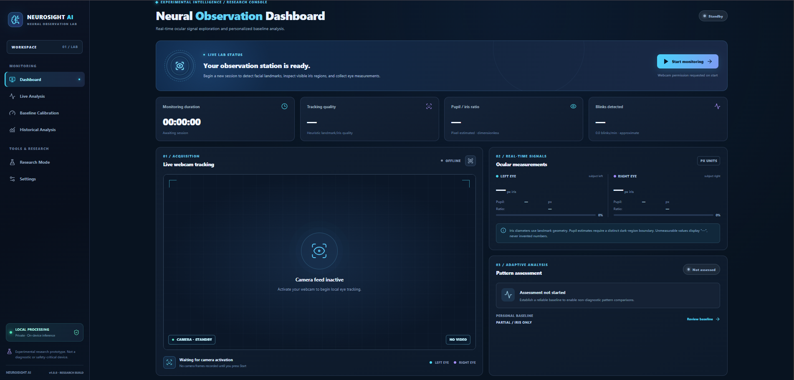
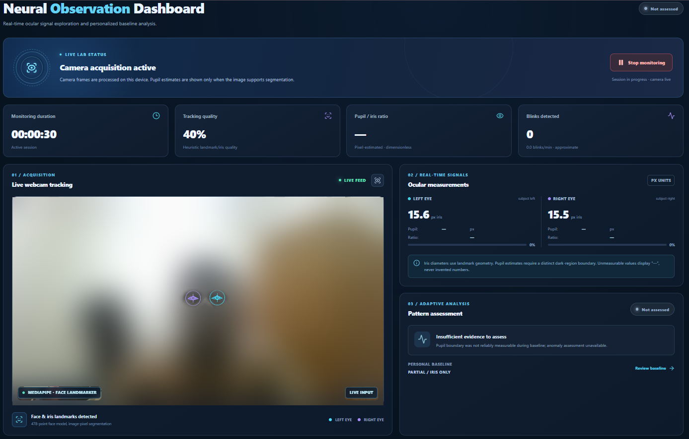
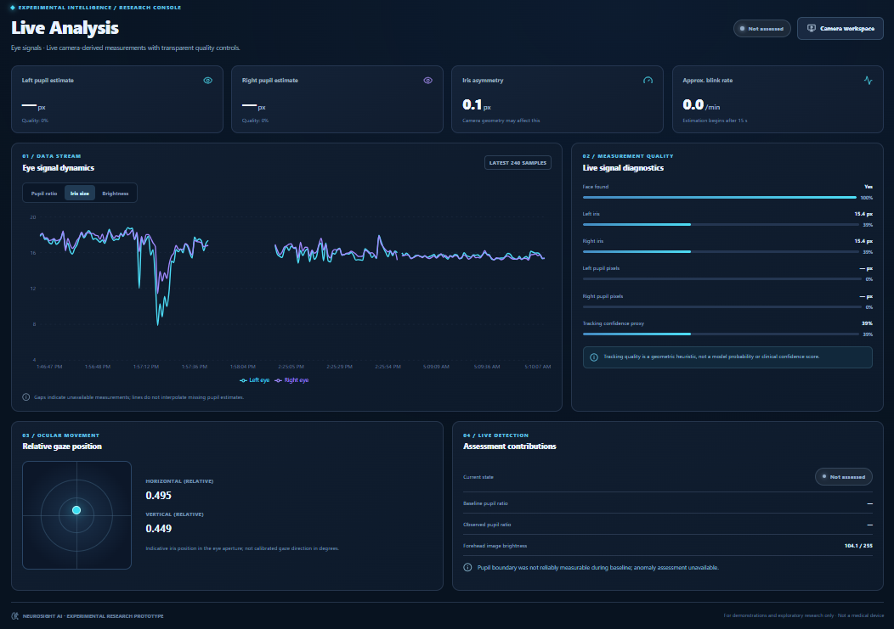
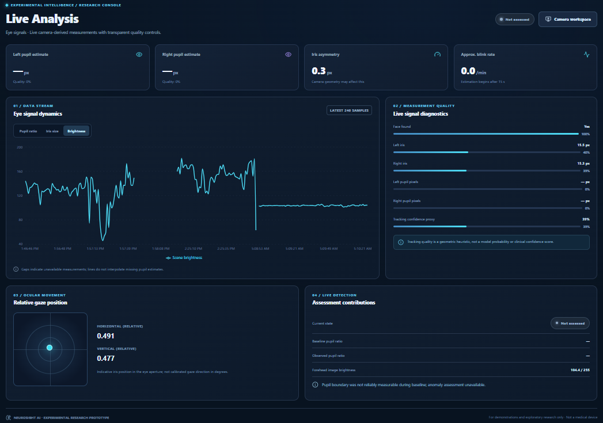
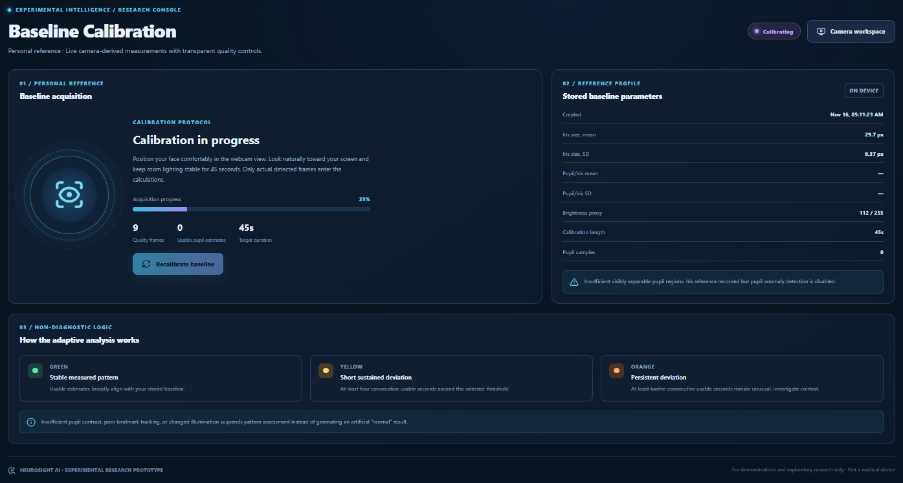
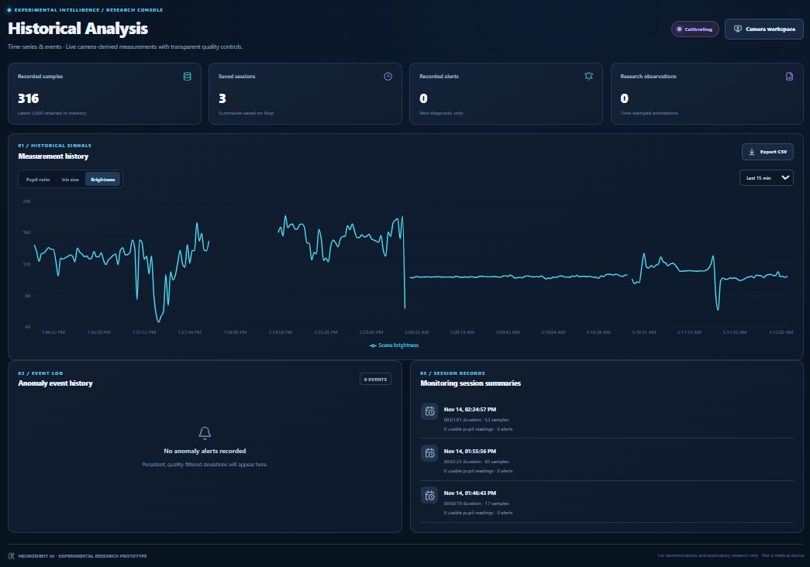
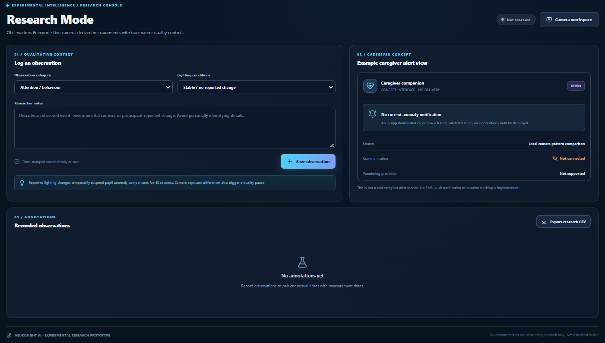
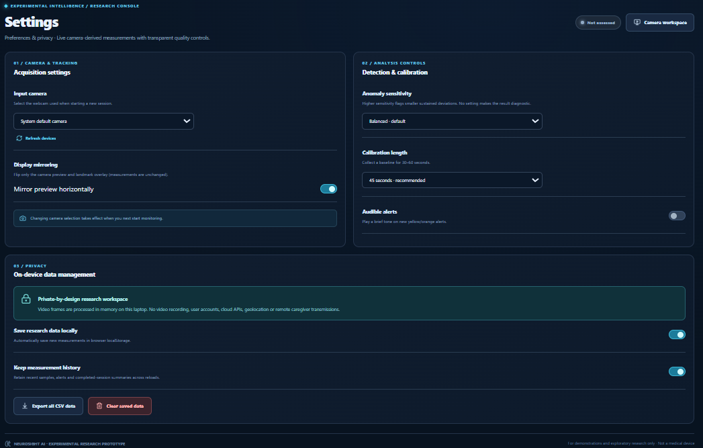

# NEUROSIGHT AI

**Experimental webcam pupillometry and eye-pattern monitoring**

NEUROSIGHT AI is a locally running React/TypeScript research-software prototype that explores whether an ordinary laptop camera can capture useful eye and pupil-related measurements over time. Its longer-term research direction is the study of pupil dynamics and cognitive-state fluctuations, including potential applications in disorders such as dementia with Lewy bodies (DLB).

**Current status: experimental prototype (v1.2). Not a medical device.** It does **not** diagnose neurological conditions, detect DLB cognitive fluctuations, predict wandering, or contact caregivers.

## What this prototype demonstrates

NEUROSIGHT AI combines webcam-based iris landmark tracking, attempted image-based pupil estimation, individual baseline calibration and exploratory time-series visualisation in a single local research interface. It can record image-derived eye features and show when a signal is too unreliable to assess. **This is a software feasibility demonstration, not evidence of successful medical screening or reliable quantitative pupillometry.**

The supplied application screenshots show **working iris tracking**, but pupil estimates were often unavailable; those sessions cannot support claims of pupil-anomaly detection. A visible iris measurement is not the same as an accurate measurement of the pupil.

## Actual application screenshots

These are screenshots of NEUROSIGHT AI running locally, **not mockups, AI-redrawn dashboards or clinical study results**. The live webcam frame has been privacy-redacted: only the eye-landmark overlays remain visible. Text, chart traces and numbers were retained from the captured application interface.

### Dashboard — camera standby



### Webcam tracking — privacy-redacted



*In this example, iris landmarks are detected but pupil estimates are unavailable. The display correctly shows "Not assessed" rather than claiming a pupil abnormality.*

### Monitoring views

| Iris-size time series | Brightness and measurement quality |
| --- | --- |
|  |  |

| Personal baseline calibration | Session history |
| --- | --- |
|  |  |

| Research notes and caregiver concept | Local processing settings |
| --- | --- |
|  |  |

**Evidence limits:** These screenshots establish that the interface displayed the listed monitoring functions during a local demonstration. They do **not** verify pupil-diameter accuracy, reliable anomaly classification, neurological disease detection or an operational caregiver alert service.

## Research idea

Pupil size can change with illumination, accommodation and physiological state. Measuring pupil-related features from consumer webcams is difficult, but a carefully quality-controlled prototype can help investigate the feasibility, errors and limitations of such measurements.

The immediate software goal is **measurement and visualisation**, not detection of disease. Any future relationship to cognitive fluctuations would require separate prospective, ethically approved studies and comparison against reliable reference measurements.

## What the v1.2 source implements

| Component | Implementation and important qualification |
| --- | --- |
| Camera | Browser webcam stream using `getUserMedia`; camera permission required |
| Eye landmarks | MediaPipe Face Landmarker geometry including iris landmarks |
| Iris measurement | Left/right apparent iris diameter in **image pixels**, not millimetres |
| Pupil estimation | Separate image-luminance segmentation with rejection of unreliable pupil boundaries |
| Baseline | Individual 30/45/60-second calibration; pupil baseline requires at least 12 usable estimates |
| Pattern monitoring | Experimental thresholds for consecutive usable samples; suppressed when data are unavailable or lighting changes |
| Live display | Eye crops with measured overlays, gaze estimates, blink approximations, plotted readings and event history |
| Local records | Browser-local settings, session history and CSV export; no server upload in the supplied code |
| Notifications | On-screen caregiver **concept** panel, **not** real push/SMS notification |

Pupil estimates can be unavailable on ordinary laptop webcams, and the software should show missing data instead of substituting fabricated measurements.

## Source code and getting started

This repository contains the original **NEUROSIGHT AI v1.2 source files** from the supplied project ZIP, including the React app, image-analysis module, tests, and Windows launcher. The research-focused README and method notes have been edited for clarity; the application source files are unchanged from the ZIP. See [implementation status](docs/implementation_status.md).

To run on Windows with Node.js installed:

```powershell
npm install
npm run dev
```

Visit `http://localhost:5173` in a modern Chrome/Edge browser, allow camera access, and select **Start monitoring**. The first installation obtains the verified MediaPipe model and runtime files. See `WINDOWS_LAUNCH_GUIDE.md` in the source ZIP.

After installing dependencies, the source package provides:

```powershell
npm run test:engine
npm run build
```

The supplied ZIP includes a small set of unit tests; those tests are **not** a clinical performance evaluation.

## How the measurements work

1. Read camera frames locally and locate facial and iris landmarks.
2. Estimate iris geometry and, when image quality permits, attempt separate pixel-based pupil segmentation.
3. Reject or mark measurements unavailable if the pupil boundary, visibility or lighting is unreliable.
4. Build a device- and lighting-specific baseline from usable observations.
5. Plot changes relative to that baseline and flag persistent deviations under experimental thresholds.

Read [scientific methods and limitations](docs/methods_and_limitations.md) for the distinction between iris tracking, pupil segmentation, relative measurements, and medical inference.

## Camera quality and measurement conditions

The camera is a major limitation of this prototype. Higher image resolution, sharper focus, suitable working distance and stable, diffuse illumination **may improve** visible iris landmarks and the opportunity to segment the pupil. A better camera does **not** guarantee accurate pupil measurements, and greater resolution alone cannot correct auto-exposure, reflections, head motion, off-axis gaze or algorithmic errors.

For reproducible exploratory demonstrations, use stable front lighting, avoid glare and backlighting, keep the eyes clearly visible, and minimise camera-to-face distance changes. Record the camera model, resolution, lighting and tracking-quality limitations when comparing sessions. The app measures apparent dimensions in **pixels**, not calibrated physical pupil diameter in millimetres.

**A webcam measurement should not be interpreted as a clinical biomarker unless the measurement method has been separately validated against a suitable reference instrument.**

## Research roadmap

- **Measurement validation:** Compare webcam pupil estimates against independently annotated images and a validated pupillometry instrument, across lighting and viewing conditions.
- **Repeatability:** Test between-session stability, quality rejection rates and errors caused by distance, gaze and spectacles.
- **Neuroscience research:** Only after measurement validation, investigate whether independently measured cognitive-state fluctuations correlate with pupil dynamics under an approved study protocol.
- **Future adaptations:** Explore uses in other non-diagnostic eye-movement, lighting-response or human–computer interaction research, subject to separate validation of the relevant measurement and analysis.
- **Caregiver-support concepts:** Evaluate feasibility and safety separately. No emergency, clinical, or wandering-risk function is established.

## Privacy, safety and evidence

The supplied application is designed for local processing with browser `localStorage`; raw webcam frames are not intentionally uploaded or saved. That does not replace a formal privacy/security audit. Do not use this prototype for diagnosis, clinical care, or unattended safety monitoring.

The app does not provide evidence of clinical sensitivity, specificity, predictive value or validated DLB biomarkers. Graphs represent camera-derived observations and heuristic values, not confirmed neurological abnormalities. Pupil-related alerts require a reliable pupil-specific baseline: a partial **iris-only** baseline must not be interpreted as a pupil-anomaly assessment.

Future reuse in other related research areas is a **possibility**, not an implemented or scientifically verified capability. Each new application would need its own measurement standards, comparison controls and, where human participants are involved, appropriate consent and ethics review.

## Project details

**Project:** NEUROSIGHT AI  
**Focus:** computer vision, webcam-based pupillometry, local biomedical monitoring, research-software prototyping  
**Version of supplied source:** 1.2.0

The scientific intent and limitations of the source are described here without asserting that unperformed validation has been completed.

## Development and reuse

NEUROSIGHT AI is an experimental research-prototype concept developed by Lathushan RK. AI-assisted tools supported aspects of the technical implementation and refinement. Scientific interpretation and clinical applicability remain unvalidated.

The source ZIP includes a [third-party license notice](LICENSE-THIRD-PARTY.txt), but does not include a standalone open-source license for the original application. Do not assume the project is MIT-licensed merely because its dependencies use open-source licenses.
